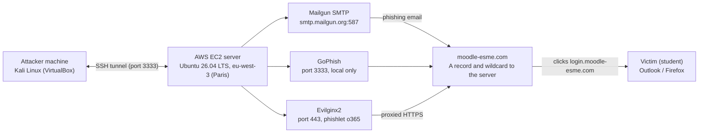
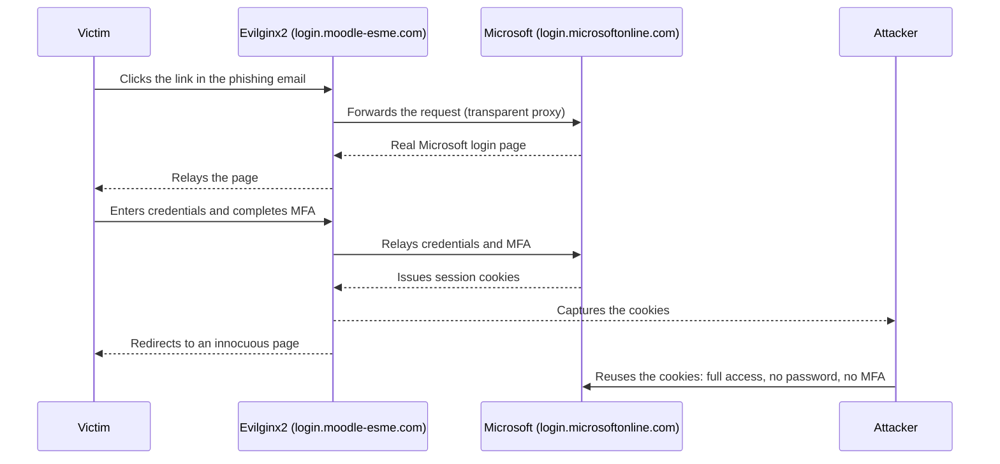

# Phishing Simulation and MFA Bypass: an AiTM Case Study

> **To what extent do modern offensive tools enable MFA bypass, and how do psychological vectors amplify their effectiveness?**

Academic red team exercise conducted at [ESME Sudria](https://www.esme.fr/) (2025-2026), demonstrating how Adversary-in-the-Middle (AiTM) attacks defeat multi-factor authentication by intercepting session cookies.


## Table of Contents

- [Overview](#overview)
- [Attack Architecture](#attack-architecture)
- [Attack Flow: How AiTM Bypasses MFA](#attack-flow-how-aitm-bypasses-mfa)
- [Social Engineering Design](#social-engineering-design)
- [Key Results](#key-results)
- [MITRE ATT\&CK Mapping](#mitre-attck-mapping)
- [Defensive Recommendations](#defensive-recommendations)
- [Legal \& Ethical Framework](#legal--ethical-framework)
- [Tech Stack](#tech-stack)
- [Team](#team)
- [References](#references)

## Overview

This project is a **supervised academic exercise** that simulated a real-world phishing campaign against students, through their university's Microsoft 365 SSO portal. The goal was to show that **MFA can be bypassed** with freely available open-source tools, and to measure the role of **psychological manipulation** in the success of the attack.

### Key Findings

| Metric | Value |
|--------|-------|
| Sessions intercepted | 36 |
| Full token bundles captured | 3 |
| MFA bypassed | Yes |
| Account access without credentials | Demonstrated |
| Time from click to full compromise | Under 30 seconds |

> **Core insight:** MFA protects the authentication event, not the session. The cookie issued after MFA is all an attacker needs.

## Attack Architecture



### Infrastructure Components

| Component | Role | Detail |
|-----------|------|--------|
| **AWS EC2** | Cloud hosting | t3.micro, Ubuntu 26.04, eu-west-3 Paris |
| **GoPhish** | Campaign management | Email delivery, target tracking, real-time dashboard |
| **Evilginx2** | AiTM reverse proxy | Transparent MFA bypass, session cookie capture |
| **Mailgun** | SMTP relay | SPF/DKIM reputation, domain-authenticated sending |
| **SSH tunnel** | Secure access | Local port forwarding to the GoPhish dashboard |
| **Let's Encrypt** | TLS certificates | Auto-provisioned: the victim sees a valid HTTPS padlock |

## Attack Flow: How AiTM Bypasses MFA



### Step-by-step breakdown

1. **Email delivery**: GoPhish sends a crafted phishing email through Mailgun SMTP from `noreply@moodle-esme.com`.
2. **Victim clicks**: the link points to `login.moodle-esme.com`, which resolves to the Evilginx2 server.
3. **Transparent proxy**: Evilginx2 forwards the request to the real `login.microsoftonline.com` and relays the legitimate Microsoft login page back to the victim.
4. **Authentication**: the victim enters credentials and completes MFA normally, while everything is proxied in real time.
5. **Cookie interception**: Microsoft issues session cookies, and Evilginx2 captures them before forwarding them to the victim.
6. **Session hijack**: the attacker imports the stolen cookies into a clean browser with Cookie-Editor and gets full account access, with no credentials required.
7. **Redirect**: the victim is sent to an innocuous page (a Tenor GIF) and suspects nothing.

### Why MFA fails here

Traditional MFA (SMS, authenticator apps, push notifications) verifies the **authentication event** but does not bind the resulting session to the device that authenticated. The session cookie issued after MFA is a **bearer token**: whoever holds it gets access, however it was obtained.

## Social Engineering Design

The phishing email was built on **Cialdini's principles of influence** to maximize the click-through rate:

| Principle | Implementation | Effect |
|-----------|---------------|--------|
| **Authority** | Email signed by the "Head of Cybersecurity" | Establishes credibility |
| **Scarcity** | "Only 2 positions remaining" | Creates fear of missing out |
| **Urgency** | "Link deactivates once slots are filled" | Pressures immediate action |
| **Relevance** | SOC internship offer at a major defense company, matching the target profile | Makes it personal |
| **Social proof** | Official school branding and communication style | Implicit trust |
| **Fear** | Missing a unique career opportunity | Emotion overrides caution |

**Result:** recipients who noticed Outlook's "Not Verified" sender badge still clicked, because the scenario was too compelling to dismiss.

## Key Results

### Campaign Metrics

| Step | Count |
|------|-------|
| Emails sent | 1 |
| Emails delivered | 1 |
| Link clicked | 1 |
| Credentials captured | 1 |
| Full session captured | 1 |

### Evilginx2 Session Database

Over the testing period, Evilginx2 recorded **36 sessions** from multiple sources:

- **3 complete token bundles** with full Microsoft session cookies
- Credentials captured in plaintext (username and password)
- Session tokens valid for account takeover without re-authentication
- Multiple user agents and IP addresses logged

### Account Takeover: Proof of Concept

The captured cookies were imported into a clean Firefox browser (private mode) with Cookie-Editor:

1. Navigate to `microsoftonline.com`
2. Delete all existing cookies
3. Import the JSON cookie bundle from Evilginx2
4. Refresh: **full account access, no credentials entered, MFA completely bypassed**

> No emails were read and no settings were modified. Access was demonstrated, then immediately terminated, and all data was deleted.

## MITRE ATT&CK Mapping

| Technique ID | Name | Phase | How we used it |
|-------------|------|-------|----------------|
| [T1566.001](https://attack.mitre.org/techniques/T1566/001/) | Spearphishing Link | Initial Access | Crafted email with a malicious link to login.moodle-esme.com |
| [T1557](https://attack.mitre.org/techniques/T1557/) | Adversary-in-the-Middle | Credential Access | Evilginx2 reverse proxy between the victim and Microsoft |
| [T1539](https://attack.mitre.org/techniques/T1539/) | Steal Web Session Cookie | Credential Access | Session cookies intercepted after MFA |
| [T1078](https://attack.mitre.org/techniques/T1078/) | Valid Accounts | Persistence | Captured cookies grant legitimate session access |

## Defensive Recommendations

### 1. FIDO2 / WebAuthn hardware keys

**The only defense that fundamentally resists AiTM attacks.**

FIDO2 keys cryptographically bind authentication to the **origin domain**. If the victim is on `login.moodle-esme.com` instead of `login.microsoftonline.com`, the key **refuses to activate**, and the AiTM attack becomes impossible.

```
Real site:    login.microsoftonline.com  ->  FIDO2 key responds
Proxy site:   login.moodle-esme.com      ->  FIDO2 key refuses
```

### 2. Conditional Access policies

Configure Azure AD / Entra ID Conditional Access to:

- require **device compliance** before issuing session tokens;
- block sessions from **anomalous IP addresses or locations**;
- enforce **token binding** to the device that authenticated;
- require **managed devices** for sensitive applications.

### 3. Session anomaly detection

- Flag cookie reuse across **different IP addresses or locations**
- Detect **impossible travel** (a login from Paris, then from another country minutes later)
- Monitor authentication logs for AiTM proxy signatures
- Use **Continuous Access Evaluation** (CAE) to revoke tokens in real time

### 4. User awareness: check the URL, not the padlock

> The padlock means **encrypted connection**, not **trustworthy site**.

Train users to check the **full URL** in the address bar, not just the presence of HTTPS. Our attack used a valid Let's Encrypt certificate: the victim saw a legitimate padlock on a malicious domain.

## Legal & Ethical Framework

The project was carried out under strict legal and ethical constraints:

| Requirement | Compliance |
|------------|------------|
| **Art. 323-1 Code pénal** | No unauthorized access: all infrastructure was owned by the team |
| **GDPR Art. 5(1)(b)** | Purpose limitation: data used only for the academic demonstration |
| **GDPR Art. 5(1)(e)** | Storage limitation: session database cleared after the demonstration |
| **GDPR Art. 17** | Right to erasure: all captured data deleted at the end of the project |
| **NIS2 Directive** | The attack vector demonstrated is the one used against NIS2 entities |
| **Supervision** | Project supervised by Nathan Duverger at every stage |
| **Debrief** | All recipients were debriefed after the campaign |
| **Data deletion** | All credentials, cookies and session data permanently deleted |

## Tech Stack

| Area | Tools and frameworks |
|------|----------------------|
| Offensive | GoPhish, Evilginx2, Kali Linux, Mailgun |
| Infrastructure | AWS EC2, Ubuntu 26.04, SSH, Let's Encrypt |
| Defensive analysis | MITRE ATT&CK, FIDO2, Conditional Access |
| Frameworks | Cialdini, GDPR, NIS2, French Penal Code (Art. 323-1) |

## Team

| Name | Role |
|------|------|
| **Mohammadi** | Infrastructure & Cloud |
| **Ndebe-Bongelo** | Attack Execution & Testing |
| **Hadj-Naceur** | Social Engineering & Analysis |
| **Nathan Duverger** | Supervisor |

## References

- [MITRE ATT&CK: Adversary-in-the-Middle (T1557)](https://attack.mitre.org/techniques/T1557/)
- [MITRE ATT&CK: Steal Web Session Cookie (T1539)](https://attack.mitre.org/techniques/T1539/)
- [Microsoft: Token theft playbook](https://learn.microsoft.com/en-us/security/operations/token-theft-playbook)
- [Microsoft: From cookie theft to BEC, attackers use AiTM phishing sites as entry point to further financial fraud](https://www.microsoft.com/en-us/security/blog/2022/07/12/from-cookie-theft-to-bec-attackers-use-aitm-phishing-sites-as-entry-point-to-further-financial-fraud/)
- [Verizon DBIR 2023](https://www.verizon.com/business/resources/reports/dbir/)
- [COMCYBER-MI: État de la menace cyber 2026](https://www.interieur.gouv.fr/)
- [FIDO Alliance: How FIDO Works](https://fidoalliance.org/how-fido-works/)
- [Cialdini, R. (2006). Influence: The Psychology of Persuasion](https://www.influenceatwork.com/)
- [Proofpoint: State of the Phish 2024](https://www.proofpoint.com/us/resources/threat-reports/state-of-phish)

## Disclaimer

This repository is published for **educational and defensive purposes only**. It documents a supervised academic exercise and contains no attack tools, exploit code, credentials or operational configurations. Its goal is to help organizations understand and defend against AiTM threats.

**Do not use the techniques described here for unauthorized access.** Unauthorized access to a computer system is a criminal offense under French law (Art. 323-1 Code pénal) and equivalent legislation worldwide.

---

<p align="center">
  <i>ESME Sudria, Cybersecurity Project 2025-2026</i><br>
  <i>"The best defense is a user who knows what a trustworthy URL looks like, and why the padlock is not enough."</i>
</p>
